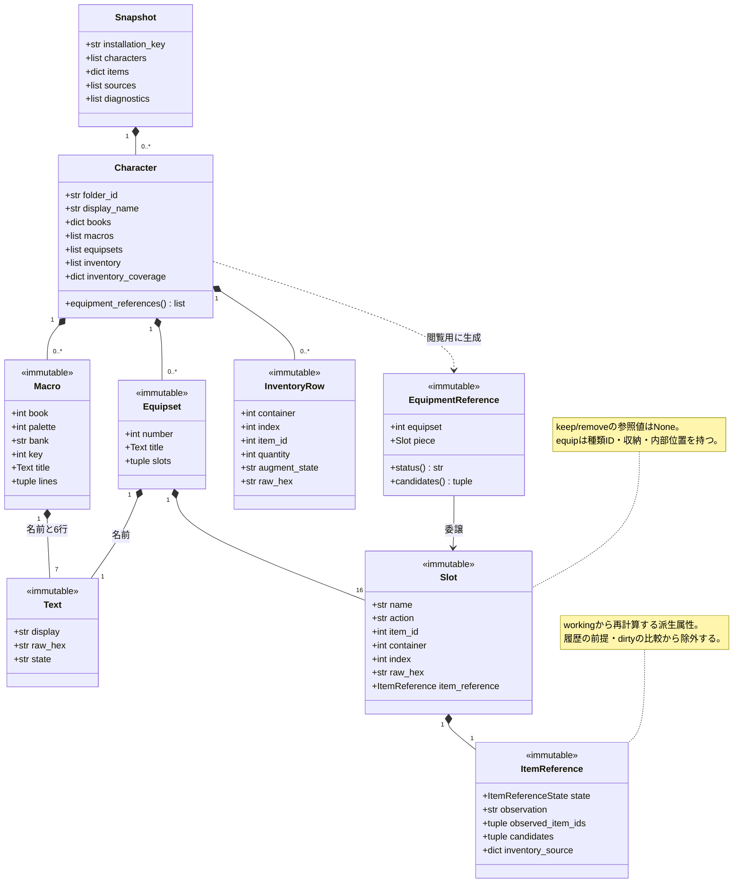
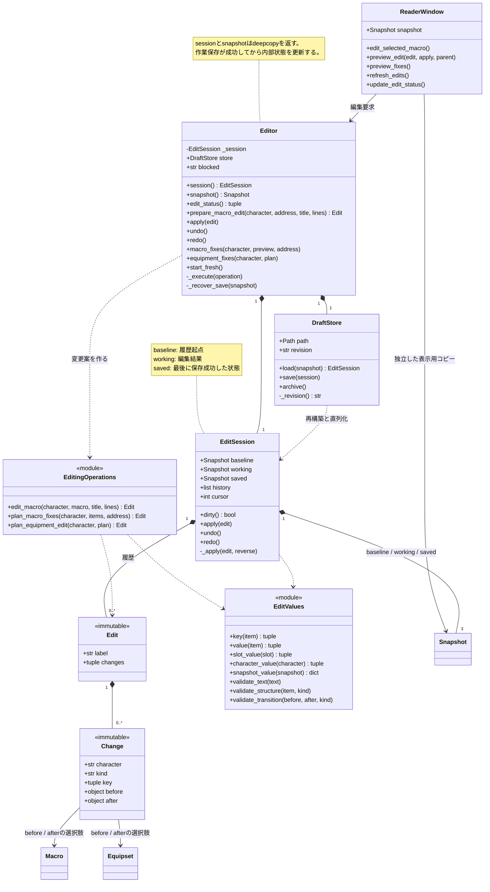
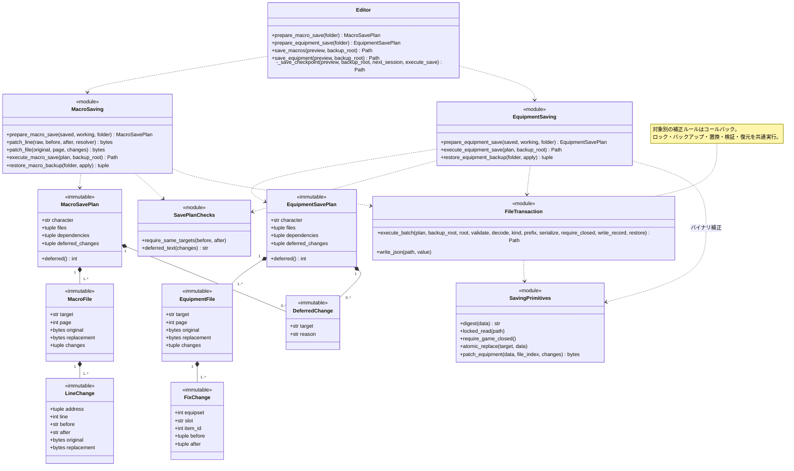
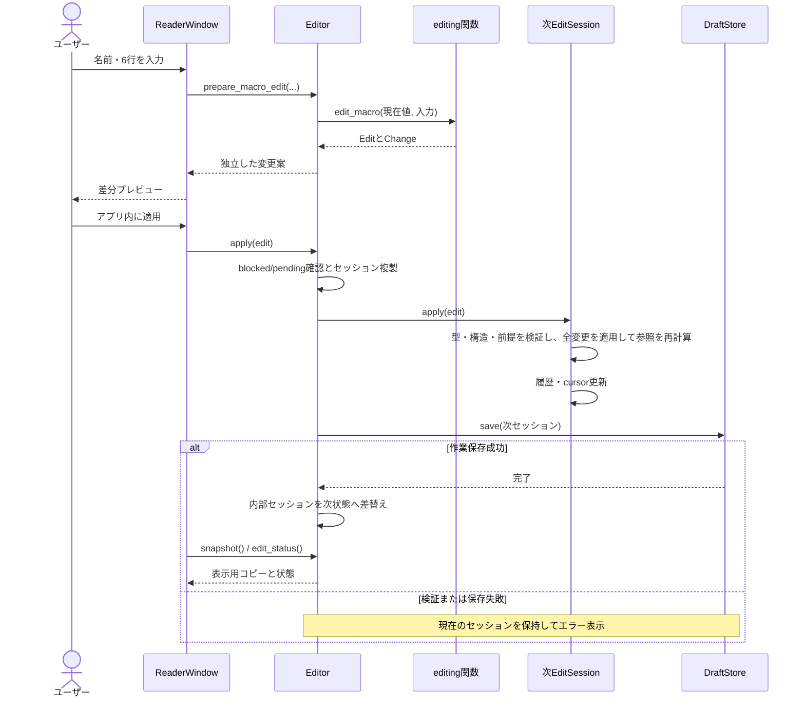
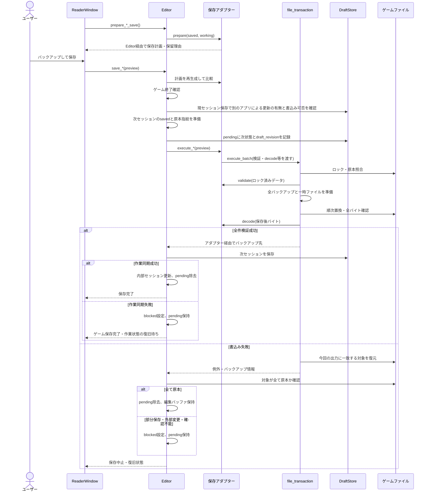

# 編集・保存のUMLと内部処理

2026-10-28、段階1実装後のコードに対応。対象はドメイン値・個別編集・編集バッファ・作業保存・ゲームへの書戻し。参照検索の全UIやバイナリ解析の詳細は省略する。

図の `<<module>>` は、同じPythonファイルに定義された関数のまとまりを表す。`*--` は所有する構成要素、`-->` は参照、`..>` は呼出し・利用を示す。属性・メソッドは主要なものを記載し、内部処理は各図の後の表で説明する。将来の一般保存サービスや移動・コピーはこの現行図に含めない。

## 1. ドメインの値

| クラス／プロパティ | 内部で行う処理 |
|---|---|
| Snapshot | 読込結果と辞書・原本指紋を保持する。編集セッションが3つの独立したコピーを持つ |
| Character | キャラ単位のデータを保持する可変コンテナ。equipment_referencesはkeep/remove以外の枠をEquipmentReferenceで包んで返す |
| Macro / Equipset / Text / Slot | frozen dataclass。値の保持を担当し、編集時は新しい値へ差し替える。編集時の構造検証はedit_valuesが担当する |
| ItemReference | 観測結果・候補とドメインの参照状態を保持する。references.assess_equipmentが生成する |
| InventoryRow | ローカルから観測した持ち物の参照元。現在は編集対象外。数量・オーグメントに取得不能の値がある |
| EquipmentReference | 検索・表示用の互換ビュー。slot、expected_item_id、container、index、status、observed_item_ids、candidates、inventory_source、certaintyはpieceへ委譲する |

## 2. 編集操作と編集セッション

### Editorの内部処理

| メソッド | 処理順・失敗時の扱い |
|---|---|
| __init__ | DraftStoreを用意 → pending復旧 → 作業ファイル読込。復旧・再開に失敗したらblockedを設定し、読込スナップショットからセッションを作る |
| session / snapshot | セッション全体／workingのみをdeepcopyして返す。呼出元で変更してもEditor内部へ反映されない |
| edit_status | cursor・履歴数・dirtyを返す。UIのUndo／Redo有効状態と変更表示に使用 |
| prepare_macro_edit | blocked確認 → 内部workingからキャラ・座標でマクロを取得 → edit_macroで案を作成 → コピーを返す |
| apply / undo / redo | _executeへEditSessionの対応操作を渡す |
| _execute | blocked・pending確認 → セッション全体をコピー → 操作 → DraftStore.save → 内部セッションをコピーの内容へ更新。操作・作業保存の失敗では現在の状態を保持 |
| macro_fixes | 現在のworkingで補正案を再計算 → プレビューとの一致確認 → apply |
| equipment_fixes | plan_equipment_editで現在の補正案を検証してEdit化 → apply |
| start_fresh | pendingがあれば中止 → 作業ファイルをarchive → 現セッションのsavedから再開始。ディスクの再読込は行わない |
| _recover_save | pendingと作業ファイルのrevisionを照合。すでに同内容へ同期済みならpendingを除去。原本指紋がpendingと一致する場合は保存後状態を作業へ同期。旧作業と一致する場合は未書込としてpendingを除去。競合・途中状態は保留 |

### EditSession・編集操作・検証関数の内部処理

| メソッド／関数 | 内部処理 |
|---|---|
| EditSession.__init__ | 入力Snapshotをbaseline・working・savedへ個別にdeepcopyし、空履歴とcursor=0を用意 |
| dirty | snapshot_value(saved)とsnapshot_value(working)を比較。キャラ・対象のキー集合も含む |
| apply | Edit/Changeの型・構造・キー・重複を検証 → _apply → 意味上の無変更を履歴から除外 → cursor以降のRedo履歴を置換 → cursorを進める |
| _apply | workingのキー重複を確認 → コピー作成 → 全変更の対象・beforeの意味上の一致・afterのキーを確認 → 値を差替え → 全キャラの装備参照状態を再判定 → workingを更新。途中エラーでは元のworkingを保持する |
| undo / redo | cursorの前／現在のEditを_applyへ渡す。Undoはbefore/afterを逆に適用。成功後にcursorを移動する |
| edit_macro | 6行・改行/NULを検証。未変更Textを保持し、変更Textをraw_hex空・state=draftで作る。1マクロのChangeを返す |
| plan_macro_fixes | /equip参照を判定 → 補正可能な行をマクロごとにまとめる → 対象行を置換したChange群を1つのEditにする |
| plan_equipment_edit | fixes.apply_fixesで古い案を再検証し、補正後のキャラを得る → 意味上の差があるセットごとにChangeを作る |
| key / macro_key | マクロは(book,palette,bank,key)、セットは(number,)を返す |
| value / slot_value | 名前・行、または枠の動作・種類ID・収納・位置を取り出す。原本バイトと派生参照状態を含めない |
| character_value / snapshot_value / contents | 対象キーで辞書化し重複を拒否する。contentsはcharacter_valueへ委譲する |
| validate_text / integer | Textの型・文字列・改行/NUL、整数の型と範囲を検証する |
| validate_structure | Macro/Equipsetの型、名前、番号・座標、6行、所定順の16枠を検証する |
| validate_transition | 前後の構造と同一キーを確認。変更する枠の動作・ID・収納・位置を検証。未変更の未知値は保持する。Undo時にも記録された順方向の遷移を検証してから逆適用する |

### DraftStoreの内部処理

| メソッド／関数 | 内部処理 |
|---|---|
| _revision | 現在の作業ファイル全体のSHA-256。未作成ならNone |
| load | 版・インストール・原本指紋を照合 → dataclass履歴を復元 → v2は各対象の最初のbeforeからbaselineを復元 → 履歴を再適用 → cursorまでUndo。保存元が変わっていれば中止 |
| save | 排他lockを取得 → revision照合 → 一時JSONへ履歴・cursor・savedの原本指紋を記録 → flush/fsync → 置換 → revision更新 → lock解放 |
| archive | 作業ファイルをUUID付きの保管名へ変更し、revisionを初期化 |
| encode / decode / signature | 許可したdataclassとtupleを版付きJSONへ変換・復元。signatureは原本パスとSHA-256の整列済み一覧 |

## 3. 保存計画とファイル書込み

保存計画は、最後に保存した状態（saved）と現在の編集内容（working）の差から作る。現在の返り値はバックアップ先Path。各保存処理に共通する結果オブジェクトは後続段階の設計対象。

| メソッド／関数 | 内部処理と境界 |
|---|---|
| Editor.prepare_*_save | blockedを確認し、saved・workingを各保存アダプターへ渡す |
| require_same_targets | マクロ・セットのキー集合を比較し追加・欠落を拒否。前後の構造も検証 |
| prepare_macro_save | 原本と編集後の行を比較 → 現在の一意な/equip補正と一致する行を抽出 → その他を対象・理由付きで保留 → 元バイトから行・ファイルを変換 → 対象・全収納・辞書の指紋を検証して計画を返す |
| patch_line | 表示文字と原本バイトの境界を対応付ける。定型文6バイトを維持し、収納番号のみ変更。本文60バイトとNULを検証 |
| patch_file | マクロ座標・行番号・重複・変更前バイトを検証 → 行を置換 → MD5更新 → 再デコード |
| prepare_equipment_save | saved/workingの差を一意な位置補正案と照合 → その他を保留 → 対象ファイルと全収納を再読込・指紋確認 → ディスクの値で候補を再計算 → esN.datごとに補正する計画を返す |
| patch_equipment | 原本をデコードし対象枠・変更前値・変更先範囲を検証 → 収納・位置だけを変更 → MD5更新 → 再デコード |
| deferred / deferred_text | deferredは保留一覧の件数。deferred_textは保存可能項目がない場合などの対象・理由を整形する |
| execute_macro_save | 対象パスを検証。共通実行器のロック下でスナップショットを再構築し、変更案を再生成してファイル・依存情報の一致を確認するコールバックを渡す |
| execute_equipment_save | パス・置換バイト・全依存情報を検証。ロックしたバイトから持ち物とセットを復元して一意な補正条件を再確認するコールバックを渡す |
| execute_batch | 下記の書込み手順を共通実行。成功時はバックアップ先Pathを返す |
| write_json | 新規JSONを排他的に作成しflush/fsyncする。receipt・verified・failure記録に使用 |
| restore_*_backup | 全対象のパス・原本・指紋・現状を先に検証。apply=Falseは確認のみ。apply=Trueは終了確認・ロック・直前再確認・置換・原本との全バイト検証。第三者の更新は上書きしない |
| digest / locked_read | SHA-256計算と読取ロック。Windowsで書込みとの競合を抑止する |
| require_game_closed / atomic_replace | ゲーム・POLプロセスを確認／同一ディレクトリの一時ファイルをflush/fsync・検証後に置換 |
| ReaderWindow.preview_game_save / preview_equipment_save | 計画を取得し対象・変更前後・ファイル・保留理由を表示。ユーザーの保存操作でEditor.save_*を呼ぶ |

execute_batchの内部手順:

1. ゲーム終了・バックアップ先・対象重複を確認する。
2. 全依存ファイルをロックし、SHA-256と対象原本バイトを確認する。
3. validateコールバックで保存対象固有の補正条件を再検証する。
4. 全原本をゲーム外へ保存・検証し、receipt.jsonへ差分と指紋を記録する。
5. 全対象の置換用一時ファイルを作成・検証する。この段階では原本を置換しない。
6. 各対象でゲーム終了を再確認し、対象ロックを解放、原本を再確認、置換、全バイト比較、decodeコールバックを実行する。
7. 途中失敗は今回の出力と一致する対象を逆順に復元し、failure.jsonへ結果を記録する。復元も失敗した場合は要確認を返す。
8. 全件成功でverified.jsonを記録して戻る。一時ファイルはfinallyで除去する。

## 4. 編集から作業ファイルへの保存

## 5. 保存とチェックポイント

next_session.savedには、保存に成功した後の状態を準備しておく。ゲームへの書込みと検証、作業ファイルへの同期が成功したら、Editorの内部状態をこのコピーへ切り替える。複数ファイルの置換は一つずつ行うため、バックアップ・pending・再起動時復旧で途中状態を扱う。

## コードの対応表

- [値と参照モデル](../ff11reader/domain.py)
- [意味上の値と検証](../ff11reader/edit_values.py)
- [編集操作・履歴](../ff11reader/editing.py)
- [ユースケースとチェックポイント](../ff11reader/edit_application.py)
- [作業ストア](../ff11reader/draft_store.py)
- [保留理由・保存対象検証](../ff11reader/save_plan.py)
- [マクロ保存](../ff11reader/macro_saving.py)／[装備セット保存](../ff11reader/equipment_saving.py)
- [共通書込み実行器](../ff11reader/file_transaction.py)／[保存プリミティブと旧単一枠保存](../ff11reader/saving.py)
- [UI](../ff11reader/ui.py)

Snapshot.capabilitiesのwrite表記には旧単一ファイル保存時代の値が残っている。図の保存経路は実際のEditor・保存アダプターの実装を基準にした。旧単一枠CLIはsaving.py内の独立した経路として残り、今回共通化したGUIの2経路とは区別する。
